# Postgres Feature Lab

A learning project: each phase demos **one PostgreSQL feature** on a tiny e-commerce backend (products, customers, orders). The goal is to see each feature work and understand why it exists, not to build a real shop.

**Stack:** Node.js · TypeScript · Express · Prisma 6 · PostgreSQL 17 (PostGIS + pgvector) in Docker

## Phases

| # | Feature | What it shows | Notes |
|---|---|---|---|
| 00 | Foundation | Express + Prisma + Postgres in Docker, 5,000 seeded products | [docs](docs/00-foundation.md) |
| 01 | JSONB | Per-category product attributes in one `jsonb` column + GIN index | [docs](docs/01-jsonb.md) |
| 02 | Full-text search | Ranked search with `tsvector`, typo-tolerant search with `pg_trgm` | [docs](docs/02-fulltext.md) |
| 03 | pgvector | _coming next_ | |

### 01 · JSONB



### 02 · Full-text search



## Run it

Requires Node 20+, Docker, and port 5433 free (the database is mapped there).

```bash
npm install
npm run db:up      # build + start Postgres (first build compiles pgvector)
npm run migrate    # apply migrations, generate the Prisma client
npm run seed       # 5,000 products, 50 customers
npm run dev        # API on http://localhost:3000
```

Try the endpoints with the Postman collection in [`postman/`](postman/pg-lab.postman_collection.json) (one folder per phase).

## Layout

```
src/features/NN-name/   # one folder per phase: CLAUDE.md spec + routes / controller / service
scripts/                # seed and benchmark scripts
prisma/                 # schema + migrations (raw SQL for Postgres-specific features)
docs/NN-name.md         # what it is, the SQL that matters, what I measured, gotchas
docs/anim/              # one animated SVG per phase
```
