# 03 pgvector



**Decision: option A, a local model.** `Xenova/all-MiniLM-L6-v2` runs through `@huggingface/transformers` (Transformers.js) ^3.8.1. It needs no API key, runs offline after the first download, and outputs **384 dimensions** (mean pooling, normalized). 3.x was chosen over the brand-new 4.x line because 4.x hasn't been confirmed on Node 20.16. pgvector is v0.8.7, built into the Postgres 17 image.

## What it is
An **embedding** turns text into a list of numbers (a vector) so that texts with similar *meaning* end up close together. pgvector adds a `vector` column type, distance operators (`<=>` cosine, `<->` L2, `<#>` inner product), and approximate nearest-neighbor indexes (HNSW, IVFFlat). That lets Postgres answer "what is closest to this?" directly.

## The SQL that matters
```sql
CREATE EXTENSION IF NOT EXISTS vector;
ALTER TABLE "Product" ADD COLUMN "embedding" vector(384);
CREATE INDEX product_embedding_hnsw ON "Product" USING hnsw (embedding vector_cosine_ops);

-- nearest neighbours by cosine distance (0 = same direction)
SELECT id, name, embedding <=> '[0.01, -0.03, ...]'::vector AS distance
FROM "Product"
ORDER BY embedding <=> '[0.01, -0.03, ...]'::vector
LIMIT 10;
```

## What I measured
**Embedding:** `npm run embed` processed 5,000 products on CPU in **211.4 s** (about 24 products/s, batches of 100). It's a one-time cost. After that, each search embeds only the query.

**`GET /products/1/similar`** (product 1 = "Modern Recycled Running Shoes"):

| similar product | distance |
|---|---|
| Eco Recycled Running Shoes | 0.191 |
| Rugged Recycled Running Shoes | 0.217 |
| Deluxe Recycled Running Shoes | 0.226 |
| Lightweight Aluminum Running Shoes | 0.232 |
| Pro Recycled Running Shoes | 0.241 |

All five are running shoes and the distances are small. This is the strongest result of the phase.

**`something to keep my coffee hot`:**

| | result |
|---|---|
| `/search` (FTS) | `[]`, 0 rows. `websearch_to_tsquery` ANDs every word (`someth & keep & coffe & hot`), and no product contains all of them. |
| `/search/semantic` | Top 5 are all **Coffee Grinders** (Kitchen), distance 0.507–0.524. |

**`a gift for a kid who likes building things`:** Building Blocks and Toy Cars (Toys) at 0.53–0.55, mixed with **Desk Organizers** (Office, 0.526 at #1).

Honest reading:
- Semantic search returns *something relevant* where FTS returns nothing, because it doesn't need every word to match.
- But distances around 0.5 are **weak matches**. The model locked onto the strongest concept word ("coffee", "gift") instead of the intent ("keep hot", "kid"). The Travel Mug and Vacuum Flask we added didn't reach the top 5: their descriptions never mention drinks or heat, so they have little meaning to match on.
- The desk organizers rank high because the seed descriptions are templated ("great as a gift", "built to last") and repeat across categories. The embedding faithfully encodes that noise. **Embeddings are only as good as the text you feed them.**

## Gotchas
- **Prisma 6 can't describe HNSW indexes** (`@@index` has no `Hnsw` type), so every migration Prisma generates from now on will try to `DROP INDEX product_embedding_hnsw`. The drift check confirmed it: the generated migration was just `DROP INDEX "product_embedding_hnsw";`. Always use `--create-only` and delete that line (or the whole folder, if it's the only line).
- **The query vector must be a constant** for HNSW to be used: `ORDER BY embedding <=> $1::vector`. The similar endpoint reads the product's vector first instead of self-joining.
- **Same model for documents and queries.** Vectors from different models (or dimensions) are not comparable.
- **New rows have no embedding until `npm run embed` runs again.** The script only picks up rows `WHERE embedding IS NULL`, so it's safe to re-run. The endpoints skip NULL rows.
- **Distance tells you confidence.** 0.19 = near-duplicate, 0.5 = loosely related. A real app would set a cutoff instead of always returning 10 rows.
- The first `embed` run downloads the model (~90 MB) into the Transformers.js cache. Later runs are offline.
