# 05 PostGIS



PostGIS **3.6.4** (GEOS 3.14.1, PROJ 9.8.1), included in the phase 00 image `postgis/postgis:17-3.6-alpine`.

## What it is
PostGIS adds spatial types, functions and indexes to Postgres. **`geography` vs `geometry`:** `geography` treats coordinates as lng/lat on the round Earth and measures in **meters**, while `geometry` works on a flat plane in the units of its SRID (degrees for 4326). "km from a customer" therefore needs `geography`.

## The SQL that matters
```sql
CREATE EXTENSION IF NOT EXISTS postgis;
CREATE TABLE "Store" (id serial PRIMARY KEY, name text NOT NULL, location geography(Point, 4326) NOT NULL);
CREATE INDEX store_location_gist ON "Store" USING GIST (location);

-- stores within 10 km, nearest first. ST_MakePoint takes (lng, lat)!
SELECT s.id, s.name, ST_Distance(s.location, q.p) / 1000 AS km
FROM "Store" s, (SELECT ST_SetSRID(ST_MakePoint(31.2357, 30.0444), 4326)::geography AS p) q
WHERE ST_DWithin(s.location, q.p, 10000)
ORDER BY ST_Distance(s.location, q.p);
```

## What I measured
200 stores seeded within 25 km of Tahrir Square, Cairo (30.0444, 31.2357).

| request | result |
|---|---|
| nearby, 10 km | **31 stores** (expected ≈ 200 × (10/25)² = 32), nearest first: Store 010 1.54 km, Store 061 2.44 km, … |
| nearby, 2 km | 1 store (Store 010, 1.54 km) |
| nearby from Alexandria | 0 |
| store 1 → center | 19.31 km |
| `lat=200` | 400 |

`npm run postgis:explain`:
```
Sort  (actual time=0.175..0.177 rows=31)
  Sort Key: st_distance(s.location, '…'::geography, true)
  ->  Index Scan using store_location_gist on "Store" s  (rows=31)
        Index Cond: (location && _st_expand('…'::geography, '10000'))
        Filter: st_dwithin(location, '…'::geography, '10000', true)
        Rows Removed by Filter: 22
Execution Time: 0.223 ms
```
- **The planner picked the GiST index even with only 200 rows.** I expected a Seq Scan, but the forced (`enable_seqscan = off`) and default plans came out identical.
- **There are two steps.** The index does a cheap bounding-box test (`&&` against a box expanded by 10 km), which gave 53 candidates. Then the exact `st_dwithin` on the spheroid removed 22 of them (box corners outside the circle), leaving 31.
- **The first call took 37.5 ms; the second took 0.22 ms with the same plan.** The one-time cost is most likely PostGIS loading and caching its spatial setup in that new connection (planning time also dropped, 1.5 → 0.2 ms). Always measure warm.
- The planner estimated `rows=1` but got 31. Selectivity estimates for geography are rough, and that's harmless here.

## Gotchas
- **`ST_MakePoint(lng, lat)`: longitude first.** Swapping them puts Cairo (30.04 N, 31.24 E) at 31.24 N, 30.04 E, on the coast just east of Alexandria, about 180 km away, and nothing errors.
- **Use `ST_DWithin` in `WHERE`, not `ST_Distance(...) < x`.** Only `ST_DWithin` expands into the index condition (`&&`). `ST_Distance` would be computed for every row.
- **`Unsupported(...)` is required here, not optional.** The spec makes `location` `NOT NULL`, and the schema must match the DB. Prisma *can* express GiST indexes (`@@index(..., type: Gist)`), and the drift check showed no PostGIS drift.
- **The HNSW gotcha from phase 03 bit again.** The generated `postgis_stores` migration started with `DROP INDEX "product_embedding_hnsw";`, and I deleted it by hand. Every future migration needs that check.
